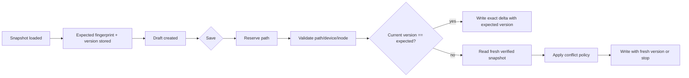

# File Revision and Reload

AudioMator must decide whether a file on disk is still the file a draft was created from. It uses conservative revision checks, explicit conflict policies, and bounded reload paths. This document describes the current behavior and its limits.

## Two Revision Guards

| Guard | Captured by | Compares |
| --- | --- | --- |
| App fingerprint | `AudioFileFingerprint.capture` | normalized path, file size, content modification date, device number, inode |
| Package version | `TagLibMetadataManager.fileVersion` | opaque `MetadataFileVersion` owned by `TagLibAudioMetadata` |

Neither guard is a content hash. The fingerprint detects common replacements and edits; the package version adds the dependency's own transaction check. AudioMator does not inspect the package version's internal fields.

Consequences, verified by app-hosted tests:

- Changing permissions can invalidate the package version while the app fingerprint remains equal.
- Changing only the modification time invalidates the app fingerprint without changing bytes.
- Replacing a file with an identical copy changes the inode and invalidates both.
- Editing bytes while restoring the modification time can defeat the app fingerprint; the package version is the remaining guard.

A conflict therefore does not prove that tags changed. It proves that the app cannot establish an unchanged revision.

## Rules

1. Never retry a failed commit with `expectedVersion: nil` or by accepting the current version. That can overwrite concurrent edits.
2. Never trust a basic tag projection as proof that native metadata is unchanged.
3. Never substitute a different file that "looks the same" after a move, replacement, or delete.
4. A semantic snapshot cannot prove audio identity, so same-path replacement is refused even under priority policies.
5. When the original device or inode is unavailable, every known identity component must still match. Size, modification time, and the original package version must remain unchanged. Editing an unchanged revision is permitted; automatic rebasing and refreshing an editor baseline to a changed revision are refused until an explicit reload. A fresh snapshot/version pair alone cannot establish continuity with the original file.

## Where Revision Checks Happen

Strict paths (preview-based imports, online plans, renumbering, lyrics, erase) require an unchanged revision and do not rebase. Inspector and Metadata Editor drafts support the configurable policies below.

## Conflict Policies

Stored in `UserDefaults` under `metadata.conflictPolicy`. Missing or unknown values select `mergeNonConflicting`. The value is read at the start of each file save, so changing the setting and retrying a draft is supported.

| Policy | Different fields changed on disk | Same edited group changed on disk |
| --- | --- | --- |
| `Merge non-conflicting changes` (default) | Merge silently | Keep the draft and stop; accept exact single-field convergence |
| `Prefer my changes` | Merge silently | Apply the draft; may overwrite the external value |
| `Prefer disk changes` | Merge silently | Keep the disk group and report discarded draft fields |
| `Require manual reload` | Stop if the revision changed | Keep the draft and require reload |

Fields are compared as conservative groups:

- track number + total tracks,
- disc number + total discs,
- year + release date,
- performer + musician credits,
- the complete artwork set.

Raw editor saves compare edited property keys and the native structures mapped to them. Unknown custom keys use a conservative comparison of all native ID3/MP4/ASF structures.

## Reload Paths

| Trigger | Scope | Draft behavior |
| --- | --- | --- |
| Import | Selected files | New snapshots |
| Watched-folder directory event | Whole watched folder (debounced 350 ms) | Failed reads keep last-known metadata |
| App activation | Currently selected files | Clean drafts follow; dirty drafts keep their baseline |
| **Reload from Disk** | Selected files | Asks before discarding a dirty inspector draft |
| Post-write reload | The written file | Applied while the mutation reservation is held |
| Rename completion | Moved files | Fingerprint and version recovered independently |

Reload reads are serialized with writes via `FileMutationCoordinator`. Each read has a 60-second deadline. A reload result is applied only if the file still has the same ID, URL, and snapshot identity; stale results are discarded.

### Clean versus dirty drafts

- A clean draft follows the refreshed snapshot.
- A dirty draft retains its original source snapshot and pending edits. The refresh must not silently change the save baseline.
- Edits made while a reload is in flight also keep the draft dirty.

### Explicit reload

**Reload from Disk** is available in the middle-list context menu. If the inspector has unsaved changes, the UI asks for confirmation. Raw Metadata Editor drafts are independent; reopen the editor to start from a refreshed revision.

## Detection Limits

- There is no continuous file watcher for every open file.
- Directory-entry events do not guarantee notification of an in-place child write on every volume.
- Activation checks only the current selection.
- Revision metadata can change without content changes (permissions, timestamps, backup tools restoring metadata).
- The app fingerprint is not cryptographic and is not a content hash.
- Network volumes and file providers may expose unreliable attributes or notification behavior; no guarantee is made for them.

## Failure Categories

| Category | Meaning |
| --- | --- |
| Not written | Validation, preflight, or commit failed before persistence |
| Written and refreshed | Commit and reload both succeeded |
| Written, refresh failed | Commit succeeded; snapshot could not be reloaded before the deadline |
| Partial batch | Some files committed, others failed or were skipped |
| Cancelled | Operation stopped before irreversible work |
| Manual recovery | Rename rollback was incomplete; recorded locations require user action |

A "written, refresh failed" result is not a write failure. The correct next step is reload, not retry.

## Verification Status

App-hosted tests cover:

- permission-only, timestamp-only, and content-with-restored-mtime revisions,
- unchanged-revision commits,
- merge/priority behavior, convergence, overlapping edits, raw deltas,
- number/total and artwork grouping,
- partial-batch retry,
- clean/dirty reload behavior, revision skipping, failure retention, and late result rejection,
- rename refresh recovery.

Tests use temporary copies of committed fixtures. They do not establish behavior for every real volume, file provider, or external editor.

## Related Documents

- [State and Mutation Model](STATE_AND_MUTATION_MODEL.md)
- [Metadata Pipeline](METADATA_PIPELINE.md)
- [Dependency Limitations](../Reference/DEPENDENCY_LIMITATIONS.md)
