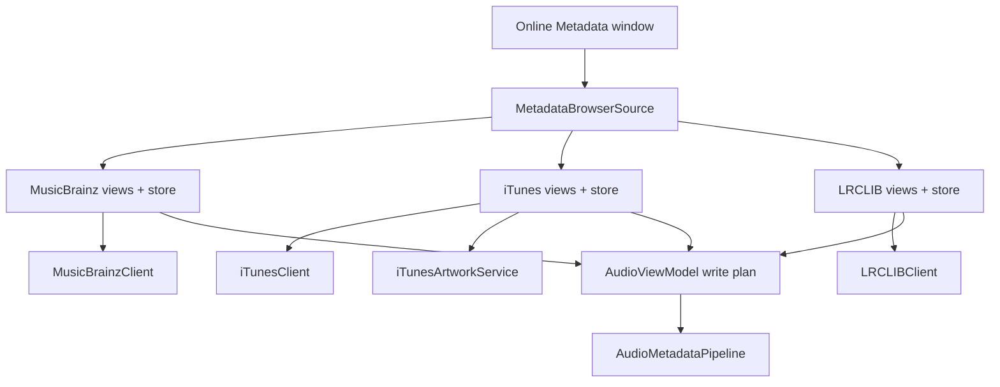

# Online Metadata

AudioMator has four opt-in network surfaces:

1. MusicBrainz metadata search and tagging.
2. Apple iTunes Search API metadata and artwork lookup.
3. LRCLIB synced-lyrics lookup.
4. GitHub release notes and manual update checks.

This document describes the integration contracts, request behavior, and concurrency constraints. It does not replace each service's own terms or documentation.

All requests are HTTP GETs through `URLSession`. There is no upload, no multipart body, and no authentication token. AudioMator does not send audio file bytes.

## Provider Architecture



- The shared window shell and source picker live in `Features/OnlineMetadataBrowser`.
- Provider-specific UI and main-actor stores live in `Features/MusicBrainzBrowser`, `Features/iTunesBrowser`, and `Features/LRCLIBLyricsBrowser`.
- URL construction, decoding, throttling, caching, and error translation live in `Infrastructure`.
- Apply actions construct a reviewed write plan carrying the captured source observation's fingerprint and nonoptional package version (`ReviewedMetadataTarget`) and go through the reviewed metadata mutation path.

### Activation and request triggers

The generic **Online Metadata** command seeds local query state and presents the provider picker; it never invokes a provider client. Choosing a source tile is also local: the MusicBrainz form, iTunes fields, and LRCLIB queue display the seeded inputs (or cached results) without starting a request. Returning to Sources, reopening the window, and LRCLIB Previous/Next do not start requests either.

Network requests begin only from provider-specific user actions:

- MusicBrainz: the Search button or Return submission in the MusicBrainz form; the explicit **Find in MusicBrainz** command from the file list, which activates MusicBrainz in a new or reused window and submits the captured query exactly once.
- iTunes: the Search button or Return submission in the iTunes form; detail loads follow explicit result navigation; artwork previews follow the explicit artwork lookup.
- LRCLIB: the Search button, Return submission, or **Auto Apply Best Matches**.

The main window hands the explicit Find action to the singleton window through a consume-once presentation intent (`OnlineMetadataActivationStore`). The window session (`OnlineMetadataBrowserSessionModel`) consumes that intent exactly once and is the only place that applies the captured MusicBrainz seed and submits the search; presentation, `onAppear`, and source selection cannot both resend it. A replacement activation follows the same session-end ownership as AM-08: MusicBrainz search cancellation and LRCLIB's store-owned session invalidation happen before the new local seed is applied.

## MusicBrainz

### Endpoints

Base: `https://musicbrainz.org/ws/2`

| Operation | Path | Parameters |
| --- | --- | --- |
| Recording search | `/recording` | `query`, `fmt=json`, `limit` |
| Release search | `/release` | `query`, `fmt=json`, `limit` |
| Recording lookup | `/recording/{mbid}` | `fmt=json`, `inc=…` |
| Release lookup | `/release/{mbid}` | `fmt=json`, `inc=…` |

Recording lookup requests relationships, credits, ISRCs, genres, tags, ratings, annotation, releases, and relationship types. Release lookup requests credits, genres, tags, annotation, labels, recordings, release groups, media, disc IDs, and ISRCs.

### Headers and scheduling

- `User-Agent`: `AudioMator/<marketing version> (https://github.com/ChrisLloydME/AudioMator; <bundle id>)`
- `Accept: application/json`
- Request timeout: 15 seconds.
- Process-wide rate limiter: minimum 1.1 seconds between request grants. Waiters are FIFO; cancellation leaves a reserved slot rather than collapsing the schedule.
- HTTP 503: up to two retries with delays of about 2.15 s and 4.3 s.
- HTTP 429 and other statuses are not retried.
- Multi-query searches continue past a 5xx when other clauses may still succeed; the last 5xx is rethrown if nothing was collected.

### Cache

Each `MusicBrainzClient` owns an in-memory response cache:

- 128 entries, 16 MiB total,
- LRU eviction, in-flight request coalescing,
- 30-minute TTL for searches,
- 7-day TTL for lookups with an ID.

Before a successful body is admitted, the coalesced loader decodes it with the exact expected response shape for that request: recording search, release search, recording lookup, or release lookup. A non-2xx status, transport timeout or cancellation, or a body that does not decode to the expected shape throws and leaves no cache entry, so retrying the same URL performs a new rate-limited request and can recover without opening a new window or client. Admission is part of the shared load rather than the first caller: cancelling one waiter neither drops a successful shared response from the cache nor starts a second fetch while the load is in flight. The cache remains byte-based; the caller decodes the returned bytes again with the same deterministic decoder configuration. Search and lookup numeric fields that the provider may send as a JSON number or a numeric string are decoded by a field-level helper: absent/null keeps the documented default, while malformed, overflowing or nonfinite values fail the whole response with an error naming the field. The release-detail verification gap check compares `candidate.score - 8` against the next score without subtracting two unbounded provider values.

The cache is not persisted. The rate limiter is shared across clients.

### UI limits

`MusicBrainzBrowserStore`:

- search timeout: 45 seconds,
- detail timeout: 15 seconds,
- release-recording preload budget: 20 seconds,
- full release recording preload limit: 35.

The client limits release-detail fan-out to the first three candidates and bounds multi-file fallback clauses.

## iTunes Search API and Artwork

### Endpoints

- `https://itunes.apple.com/search`
- `https://itunes.apple.com/lookup`

Search parameters: `term`, `country`, `media=music`, `entity`, `limit` (clamped 1…200). Lookup parameters: `id` (album or track) or `upc`, `country`, optional `entity=song`, `limit=200`. The metadata browser adds one language query item (`lang` or `l`, depending on the selected language) to searches and lookups when a user chooses a storefront alternative. It omits the item for the storefront default.

No custom `User-Agent` is set. Request timeout: 15 seconds. There is no retry, rate limiter, or HTTP response cache; the browser store keeps an in-memory remote-detail cache keyed by storefront, language and collection ID.

A multi-file album search can make up to roughly 18 sequential album-detail requests plus representative track searches. Cancellation is checked between requests.

### Data sent

Only the request parameters above are sent. In particular, duration, track number, disc number, iTunes artist ID, and catalog ID are **not** URL parameters; they are used for local matching or tag writing only.

Queries can be derived from tags **or from filename/parent-directory fallback** when tags are missing.

### Storefront-scoped results and details

A completed search publishes the results, submitted query, storefront, local selection, and request generation together. Changing the storefront or language cancels pending search work, clears the publication and submitted query, and resets result navigation. Completions must match the current storefront, language, search operation and session. Album and track result destinations carry the submitted region and language into detail lookups, including lookups opened from other details. The raw iTunes `country` field on an album or track is display data.

Remote album detail is cached by `(storefront, language, collectionID)` and stores only the raw album and tracks. Selection-match previews are resolved per read from the captured submitted selection. Result fallback previews also require a match on storefront, language, album and local selection lineage. A session generation prevents a detail completing after close/reopen from repopulating the closed session's cache.

### Provider tag application

A provider release date maps only to semantic `releaseDate` (`.releaseDate`). It never sets, derives, synchronizes or clears `year`, `date` or `originalReleaseDate`. A release year used for search ranking or display is not a stored Year value and is never added to the edit intent. Providers that do not supply Year leave Year unchanged. Applying provider values still uses the shared `MetadataEditPayload` and all-or-nothing per-file preflight; only the explicitly selected comparison rows are written, and the existing cancellation/version/audio-identity rules apply.

### Artwork

Artwork search transforms Apple's `artworkUrl100` into:

- a thumbnail URL (Apple host as returned),
- a standard 600×600 URL (Apple host as returned),
- a high-resolution URL rewritten to `is5-ssl.mzstatic.com`,
- an uncompressed URL rewritten to `a5.mzstatic.com` when derivable.

Downloads try the preferred URLs in order and stop on the first success. There is no host allow-list; if Apple returns a different host in `artworkUrl100`, that host is contacted. The disclosure lists the core artwork hosts and explicitly notes that Apple-returned URLs can contact additional hosts. The download policy itself remains unrestricted.

Downloaded bytes are normalized locally before preview/application. Full payload comparison is used for equality; sampled hashes are not.

The lookup sheet keeps search faults and candidate download faults separate. A failed or cancelled search is terminal for that result set until **Search Again** starts a new search attempt in the same sheet. A failed, timed-out, or cancelled candidate download keeps the settled result grid and the selected candidate, reports the reason inline next to the preview, and turns the primary action into **Try Again** for that candidate; selecting another candidate clears the candidate fault without repeating the search. Only one download/apply attempt runs at a time: Apply and candidate selection are disabled while it runs, **Stop Download** cancels it, and a duplicate Apply does not start a second attempt. Every completion is checked against the session and attempt identity before it may publish an image, fault, or progress state, so a superseded attempt cannot clear a newer one. The selected preview is keyed by candidate identity, so a candidate change starts the preferred-preview URL fallback at the first URL, delayed failures from a previous candidate are ignored, and the URL order is preserved.

The lookup also captures its Inspector destination before starting any network work: the F3 draft session ID, artwork command generation and full ordered target set travel with the session. Applying a downloaded candidate stages only into that still-live draft while every captured target remains available; a changed selection, a new draft for the same IDs, a removed target, or a newer artwork command rejects the handoff with a localized stale-selection/superseded message and keeps the sheet and its results open for reference. No draft is created for the captured files and no surviving subset is applied. A lookup started without an editable Inspector draft is preview-only: results can be inspected, but Apply stays disabled. The same capture/commit boundary backs the Finder, photo-library and clipboard artwork handoffs.

## LRCLIB

### Endpoint

`https://lrclib.net/api/search`

Query items:

- `track_name`
- `artist_name`
- `album_name`
- `duration` (integer seconds, when positive)

Headers: `Accept: application/json` and the same `AudioMator/<version> (...)` `User-Agent` template. Timeout: 15 seconds. No retry, rate limiter, or cache.

Queries use the title, artist, and album fields plus duration. Each value comes from tags when present; missing values can be derived from the file name (title/track number) and from parent or grandparent folder names (artist and album, including an “Artist - Album” folder split). The actual HTTP query items are `track_name`, `artist_name`, `album_name`, and `duration` (duration omitted when unknown); a full file path and audio bytes are never sent. Candidate ranking prefers exact synced-lyrics duration matches and uses synced availability as a tie-breaker. The store searches per file with a limit of 20 candidates. Auto-apply requires normalized exact title and artist matches, synced lyrics, a score of at least 80, and duration within 10 seconds when both sides provide one. High-confidence auto-apply still replaces existing lyrics; it has no separate overwrite opt-in or review step.

### Applying lyrics

Applying synced lyrics writes a raw `LYRICS` patch only:

```swift
RawMetadataPatch(valuesToSet: ["LYRICS": [normalizedLyrics]])
```

It does not rewrite the whole PropertyMap. The target format must support the `lyrics` field; otherwise the operation is rejected before writing. The package's raw-intent projection only checks that the container is tag-writable, not that a specific raw key is supported, so AudioMator performs the `.lyrics` field capability preflight itself before any authorization prompt or disk handoff.

### Reviewed binding and session ownership

Each queued LRCLIB row keeps the metadata-only query input beside a reviewed target captured from the exact `AudioFile` observation that seeded the query: logical ID, operational URL, app fingerprint and package metadata version. Manual Apply and Auto Apply build those targets once at seed; selecting a candidate, navigating between rows, or a refreshed file observation never changes them. Both apply entry points accept only the frozen intents (reviewed target plus candidate identity and synced lyrics), never a file UUID plus lyrics text. Every file write is one scoped raw `LYRICS` patch through the shared strict reviewed-write route: path reservation, live-target membership/path/recovery/version recheck, the captured package version, the commit permit and a bounded reload. Inspector and Metadata Editor conflict policies do not apply to this strict operation. A file whose reviewed revision changed (including a reload or replacement that reuses the stable ID and path) is rejected with a close/reopen-and-review instruction; a mixed batch continues with the eligible files and reports the rejected ones per file.

`LRCLIBLyricsBrowserStore` owns the search-to-write lifecycle: one session ID plus a monotonic generation, and at most one operation (manual apply or auto apply) with its own identity and task. Closing the window, returning to Sources, or reseeding invalidates the generation, cancels outstanding lookups and every write that has not crossed the admission boundary, and clears candidates/results. Back to Sources retains the queued rows and their seed bindings so a fresh Search can resume; a changed file still requires a reseed (close/reopen LRCLIB or rerun the Online Metadata command) before it can be applied. A commit that already crossed the admission boundary is never interrupted: it completes and reports its real outcome, including reload or durability warnings, to the existing HUD or save issue log, while later queued files are recorded as cancelled exactly once. Provider calls that ignore cancellation may finish remotely, but late results have no authority to publish state, start another request, or start a write.

## GitHub Release Notes and Updates

### Release notes

`https://api.github.com/repos/ChrisLloydME/AudioMator/releases?per_page=50`

Headers come from `GitHubAPIRequest`:

- `Accept: application/vnd.github+json`
- `X-GitHub-Api-Version: 2022-11-28`
- `User-Agent: AudioMator`

No explicit timeout is set, so the Foundation default applies. Drafts are filtered out; prereleases are not filtered.

### Update check

`https://api.github.com/repos/ChrisLloydME/AudioMator/releases/latest`

`GitHubUpdateReleaseClient` decodes only `tag_name` (it ignores release name, body, and `html_url`), then:

- requires a tag of the form `V<version>B<build>` (uppercase markers),
- compares dot-separated integer version segments, then the integer build,
- returns update available, up to date, or ahead of latest.

There is no caching, time-based throttle, ETag handling, automatic launch check, or download. `UpdateCheckPresenter` prevents overlapping checks and always opens the static releases page (`https://github.com/ChrisLloydME/AudioMator/releases`).

## Web Content

The MusicBrainz detail view can embed MusicBrainz release/recording pages in a `WKWebView`. The iTunes detail view embeds Apple-provided track/collection view URLs.

- `EmbeddedWebView` uses a non-persistent website data store.
- Initial URLs and subsequent page navigation require HTTPS and an `apple.com` or `musicbrainz.org` host (including subdomains). Off-policy navigation is cancelled.
- These pages can load their own subresources beyond the allowed page hosts. The navigation delegate is not a subresource filter; cookies are session-only.
- The in-app network disclosure includes embedded provider pages and this subresource limitation.
- The app has no ATS exceptions and all app requests use HTTPS.

This is documented as a privacy consideration, not as a guarantee.

## Error Handling

| Condition | Behavior |
| --- | --- |
| Empty query | Rejected before a request |
| Invalid country code | iTunes client error |
| Non-2xx | Typed request failure; GitHub 403/429 maps to rate limited |
| Timeout | `URLError(.timedOut)` mapped to a timeout message |
| Cancellation | Session end invalidates the generation and cancels the operation; a precommit write is never attempted and is recorded cancelled, a commit already admitted completes and reports its real outcome |
| Malformed payload | Decoding/response-body error; a MusicBrainz response that fails its exact-shape validation is not cached and the same URL may be retried successfully |
| Restarted search | Previous task cancelled; stale results discarded by operation ID |

Provider stores are main-actor isolated. Network work runs in detached tasks or async client calls bounded by `withAsyncTimeout`. Large parsing/matching work is kept off the main actor where implemented.

## Assumptions About External Services

AudioMator assumes:

- the services remain reachable over HTTPS,
- responses match the documented JSON shapes closely enough to decode,
- MusicBrainz honors the rate limit and returns 503 when overloaded,
- Apple returns `artworkUrl100` and iTunes lookup results,
- LRCLIB returns an array of candidate records,
- GitHub tag naming follows the project's `V…B…` convention.

These are not guaranteed. API drift can break a provider independently of AudioMator.

## Verification Status

App-hosted tests use injected clients and `URLProtocol` fakes. They assert:

- URL and query construction, headers, and 15-second timeouts,
- decoding and error mapping, including 429/5xx and timeouts,
- rate-limit spacing with a deterministic clock,
- cache coalescing and eviction,
- MusicBrainz invalid-200-then-valid recovery for every request shape (invalid JSON and wrong-schema valid JSON), no cached entry on HTTP failure/timeout/transport cancellation, one shared fetch for coalesced waiters including one cancelled, and field-level alternate integer/numeric-string/default and finite-Double cases,
- iTunes publication and remote-detail caching scoped by storefront and language, with album and track entry paths using the submitted catalog settings, stale completions suppressed, and per-selection previews resolved from the captured selection,
- consume-once provider activation with fake clients: generic entry, tile selection, back/reappearance, empty selection and LRCLIB Previous/Next make zero provider calls; explicit Find in MusicBrainz submits exactly once in a new and a reused window; iTunes/LRCLIB actions never contact MusicBrainz; LRCLIB request query values are derived from synthetic paths and tagged input; disclosure strings are asserted independently,
- cancellation/restart races,
- bounded fan-out and off-main presentation,
- lyrics ranking, reviewed-target binding, strict raw `LYRICS` writes, session close/back/reseed cancellation (including a gated non-cooperative provider), mixed bulk accounting, and real FLAC/M4A fixture readback.

No automated test contacts a live service. Live API behavior, remote rate limits, Apple host selection, and WebKit subresource behavior are unverified by the test suite.

## Provider Apply Cancellation

MusicBrainz and iTunes apply stop before the next file when cancelled. A started commit is observed to completion and included in the summary, including warnings. Unprocessed entries are recorded as cancelled failures so successful, failed, and cancelled counts reconcile with the captured plan. Cancellation does not discard an already committed file's outcome.

LRCLIB apply follows the same rule with one additional owner: the browser store owns the session generation and the single operation identity. Closing the window, returning to Sources to the provider picker, or reseeding invalidates that owner before it touches task cancellation, so a non-cooperative provider completion cannot republish queue state, start a later request, or reach the write handoff. The library-browser window close is the teardown path; Back retires the operation but intentionally retains the queued rows and seed bindings for a fresh explicit Search.

## Related Documents

- [Security and Data Integrity](../Security/SECURITY_AND_DATA_INTEGRITY.md)
- [Acknowledgements and Privacy](../ACKNOWLEDGEMENTS_AND_PRIVACY.md)
- [Third-Party Notices](../THIRD_PARTY_NOTICES.md)
- [Metadata Pipeline](METADATA_PIPELINE.md)

## Bounded plan persistence

MusicBrainz and iTunes apply captured write plans through the same four-file bound used by Inspector. File values and fingerprints are captured before work begins; per-file mutation reservations, version checks, commit and reload remain intact. Completion order does not change issue ordering. Cancelling prevents queued writes from starting while reporting every in-flight commit's actual outcome. See [write-concurrency evidence](../Engineering/HISTORY/WRITE_CONCURRENCY_2026-11-12.md).
