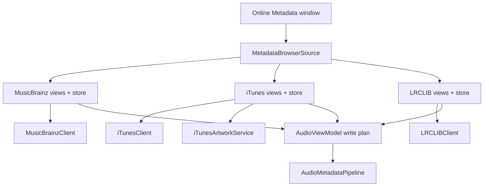

# Online Metadata

AudioMator has four opt-in network surfaces:

1. MusicBrainz metadata search and tagging.
2. Apple iTunes Search API metadata and artwork lookup.
3. LRCLIB synced-lyrics lookup.
4. GitHub release notes and manual update checks.

This document describes the integration contracts, request behavior, and concurrency constraints. It does not replace each service's own terms or documentation.

All requests are HTTP GETs through `URLSession`. There is no upload, no multipart body, and no authentication token. AudioMator does not send audio file bytes.

## Provider Architecture



- The shared window shell and source picker live in `Features/OnlineMetadataBrowser`.
- Provider-specific UI and main-actor stores live in `Features/MusicBrainzBrowser`, `Features/iTunesBrowser`, and `Features/LRCLIBLyricsBrowser`.
- URL construction, decoding, throttling, caching, and error translation live in `Infrastructure`.
- Apply actions construct a write plan with the source snapshot's expected fingerprint and go through the normal metadata mutation path.

## MusicBrainz

### Endpoints

Base: `https://musicbrainz.org/ws/2`

| Operation | Path | Parameters |
| --- | --- | --- |
| Recording search | `/recording` | `query`, `fmt=json`, `limit` |
| Release search | `/release` | `query`, `fmt=json`, `limit` |
| Recording lookup | `/recording/{mbid}` | `fmt=json`, `inc=…` |
| Release lookup | `/release/{mbid}` | `fmt=json`, `inc=…` |

Recording lookup requests relationships, credits, ISRCs, genres, tags, ratings, annotation, releases, and relationship types. Release lookup requests credits, genres, tags, annotation, labels, recordings, release groups, media, disc IDs, and ISRCs.

### Headers and scheduling

- `User-Agent`: `AudioMator/<marketing version> (https://github.com/ChrisLloydME/AudioMator; <bundle id>)`
- `Accept: application/json`
- Request timeout: 15 seconds.
- Process-wide rate limiter: minimum 1.1 seconds between request grants. Waiters are FIFO; cancellation leaves a reserved slot rather than collapsing the schedule.
- HTTP 503: up to two retries with delays of about 2.15 s and 4.3 s.
- HTTP 429 and other statuses are not retried.
- Multi-query searches continue past a 5xx when other clauses may still succeed; the last 5xx is rethrown if nothing was collected.

### Cache

Each `MusicBrainzClient` owns an in-memory response cache:

- 128 entries, 16 MiB total,
- LRU eviction, in-flight request coalescing,
- 30-minute TTL for searches,
- 7-day TTL for lookups with an ID.

The cache is not persisted. The rate limiter is shared across clients.

### UI limits

`MusicBrainzBrowserStore`:

- search timeout: 45 seconds,
- detail timeout: 15 seconds,
- release-recording preload budget: 20 seconds,
- full release recording preload limit: 35.

The client limits release-detail fan-out to the first three candidates and bounds multi-file fallback clauses.

## iTunes Search API and Artwork

### Endpoints

- `https://itunes.apple.com/search`
- `https://itunes.apple.com/lookup`

Search parameters: `term`, `country`, `media=music`, `entity`, `limit` (clamped 1…200). Lookup parameters: `id` (album or track) or `upc`, `country`, optional `entity=song`, `limit=200`.

No custom `User-Agent` is set. Request timeout: 15 seconds. There is no retry, rate limiter, or response cache.

A multi-file album search can make up to roughly 18 sequential album-detail requests plus representative track searches. Cancellation is checked between requests.

### Data sent

Only the request parameters above are sent. In particular, duration, track number, disc number, iTunes artist ID, and catalog ID are **not** URL parameters; they are used for local matching or tag writing only.

Queries can be derived from tags **or from filename/parent-directory fallback** when tags are missing.

### Artwork

Artwork search transforms Apple's `artworkUrl100` into:

- a thumbnail URL (Apple host as returned),
- a standard 600×600 URL (Apple host as returned),
- a high-resolution URL rewritten to `is5-ssl.mzstatic.com`,
- an uncompressed URL rewritten to `a5.mzstatic.com` when derivable.

Downloads try the preferred URLs in order and stop on the first success. There is no host allow-list; if Apple returns a different host in `artworkUrl100`, that host is contacted. This is a limitation of the current implementation and is not fully captured by the static three-host disclosure.

Downloaded bytes are normalized locally before preview/application. Full payload comparison is used for equality; sampled hashes are not.

## LRCLIB

### Endpoint

`https://lrclib.net/api/search`

Query items:

- `track_name`
- `artist_name`
- `album_name`
- `duration` (integer seconds, when positive)

Headers: `Accept: application/json` and the same `AudioMator/<version> (...)` `User-Agent` template. Timeout: 15 seconds. No retry, rate limiter, or cache.

Queries can use tags or filename fallback. Candidate ranking prefers exact synced-lyrics duration matches and uses synced availability as a tie-breaker. The store searches per file with a limit of 20 candidates.

### Applying lyrics

Applying synced lyrics writes a raw `LYRICS` patch only:

```swift
RawMetadataPatch(valuesToSet: ["LYRICS": [normalizedLyrics]])
```

It does not rewrite the whole PropertyMap. The target format must support the `lyrics` field; otherwise the operation is rejected before writing.

## GitHub Release Notes and Updates

### Release notes

`https://api.github.com/repos/ChrisLloydME/AudioMator/releases?per_page=50`

Headers come from `GitHubAPIRequest`:

- `Accept: application/vnd.github+json`
- `X-GitHub-Api-Version: 2022-11-28`
- `User-Agent: AudioMator`

No explicit timeout is set, so the Foundation default applies. Drafts are filtered out; prereleases are not filtered.

### Update check

`https://api.github.com/repos/ChrisLloydME/AudioMator/releases/latest`

The client decodes `name`, `tag_name`, and `html_url`, then:

- requires a tag of the form `V<version>B<build>` (uppercase markers),
- compares dot-separated integer version segments, then the integer build,
- returns update available, up to date, or ahead of latest.

There is no caching, time-based throttle, ETag handling, automatic launch check, or download. `UpdateCheckPresenter` prevents overlapping checks and always opens the static releases page (`https://github.com/ChrisLloydME/AudioMator/releases`) rather than the decoded `html_url`. The decoded URL is currently unused.

## Web Content

The MusicBrainz detail view can embed MusicBrainz release/recording pages in a `WKWebView`. The iTunes detail view embeds Apple-provided track/collection view URLs.

- `EmbeddedWebView` uses `WKWebView()` with default configuration, including the default website data store.
- Apple-provided web URLs are loaded without a host allow-list.
- These pages can load their own subresources and cookies beyond the API hosts.
- The app has no ATS exceptions and all app requests use HTTPS.

This is documented as a privacy consideration, not as a guarantee.

## Error Handling

| Condition | Behavior |
| --- | --- |
| Empty query | Rejected before a request |
| Invalid country code | iTunes client error |
| Non-2xx | Typed request failure; GitHub 403/429 maps to rate limited |
| Timeout | `URLError(.timedOut)` mapped to a timeout message |
| Cancellation | Search task cancelled; no late result published |
| Malformed payload | Decoding/response-body error |
| Restarted search | Previous task cancelled; stale results discarded by operation ID |

Provider stores are main-actor isolated. Network work runs in detached tasks or async client calls bounded by `withAsyncTimeout`. Large parsing/matching work is kept off the main actor where implemented.

## Assumptions About External Services

AudioMator assumes:

- the services remain reachable over HTTPS,
- responses match the documented JSON shapes closely enough to decode,
- MusicBrainz honors the rate limit and returns 503 when overloaded,
- Apple returns `artworkUrl100` and iTunes lookup results,
- LRCLIB returns an array of candidate records,
- GitHub tag naming follows the project's `V…B…` convention.

These are not guaranteed. API drift can break a provider independently of AudioMator.

## Verification Status

App-hosted tests use injected clients and `URLProtocol` fakes. They assert:

- URL and query construction, headers, and 15-second timeouts,
- decoding and error mapping, including 429/5xx and timeouts,
- rate-limit spacing with a deterministic clock,
- cache coalescing and eviction,
- cancellation/restart races,
- bounded fan-out and off-main presentation,
- lyrics ranking and raw write behavior.

No automated test contacts a live service. Live API behavior, remote rate limits, Apple host selection, and WebKit subresource behavior are unverified by the test suite.

## Related Documents

- [Security and Data Integrity](../Security/SECURITY_AND_DATA_INTEGRITY.md)
- [Acknowledgements and Privacy](../ACKNOWLEDGEMENTS_AND_PRIVACY.md)
- [Third-Party Notices](../THIRD_PARTY_NOTICES.md)
- [Metadata Pipeline](METADATA_PIPELINE.md)
