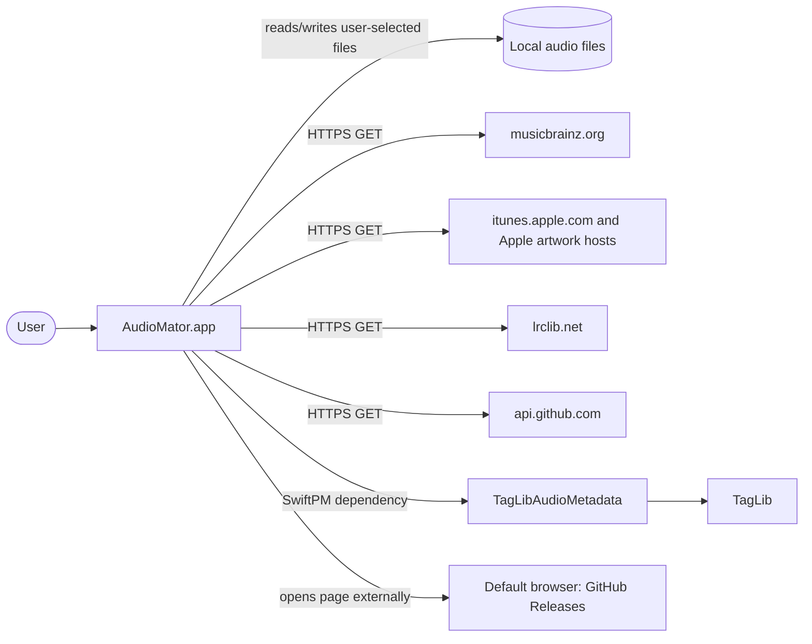
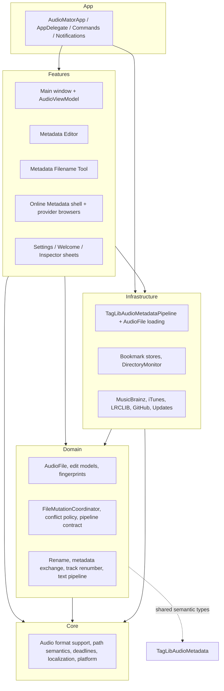
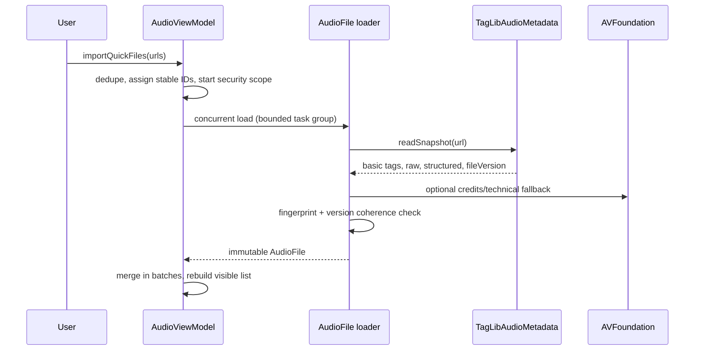
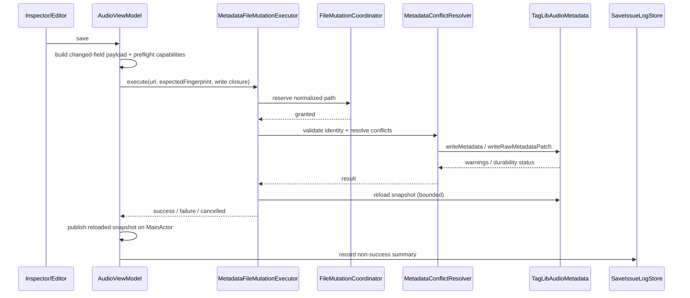

# Architecture Overview

AudioMator is a single macOS application target assembled from layered source
folders under `AudioMator/`. The application is deliberately small at the center:
a SwiftUI app shell owns lifecycle, a main-actor view model owns file state and
selection, and all container-specific metadata I/O is delegated to the
`TagLibAudioMetadata` package through an adapter protocol.

This document describes the current structure. Detailed behavior lives in the
linked architecture documents.

## Context

All network operations are user initiated. The app does not upload audio
content. See [Security and Data Integrity](../Security/SECURITY_AND_DATA_INTEGRITY.md).

## Layer Structure

The allowed dependency direction and its one documented exception are in
[Dependency Rules](DEPENDENCY_RULES.md).

## Composition Root

`AudioMator/App/AudioMatorApp.swift` is the only composition root:

1. Creates one `TagLibAudioMetadataPipeline` and one `SaveIssueLogStore`.
2. Injects the pipeline and log store into `AudioViewModel`.
3. Creates `SharedState`, `MusicBrainzBrowserStore`, `LRCLIBLyricsBrowserStore`,
   `MetadataFilenameToolStore`, and a second `MetadataEditorStore` bound to the
   same pipeline.
4. Declares five scenes:
   - the main `WindowGroup` (`ContentView`),
   - `Settings` (`SettingsView`),
   - the Online Metadata window (`OnlineMetadataBrowserView`),
   - the Filename & Metadata window (`MetadataFilenameWindowView`),
   - the Metadata Editor window (`MetadataEditorWindowView`).
5. Registers app-info, sidebar, toolbar-edit, and view-layout commands.

Feature views receive dependencies explicitly. There is no service locator and no
feature-level singleton for metadata I/O.

## Application Lifecycle

- `AudioMatorApp` is the `@main` SwiftUI app and installs `AppDelegate` through
  `NSApplicationDelegateAdaptor`.
- On first launch, `AppDelegate` checks `hasLaunchedBefore`; if unset, it sizes
  the first window to 900×600, centers it, and stores the flag. Later launches
  keep the system-restored window state.
- The app terminates when the last window closes
  (`applicationShouldTerminateAfterLastWindowClosed`).
- The welcome sheet is presented based on `hasCompletedWelcomeSplash` and
  `completedWelcomeSplashVersion`; it can also be reopened from the Help menu.
- Commands and cross-window actions communicate through
  `NotificationCenter` names in `AppNotifications.swift` or through injected
  bindings. The main window observes notifications for metadata dump, track
  renumber, online metadata, select-all, sidebar changes, inspector toggling, and
  the welcome screen.
- `ContentView` runs selected-file reconciliation when the app becomes active.

## UI Composition

- The main window is a `NavigationSplitView` with a sidebar, a middle content
  pane, and an `.inspector` column. The inspector can be toggled; its width is
  constrained to 340–480 points.
- The middle list uses an AppKit-backed table (`MiddleListTable`) bridged into
  SwiftUI for native selection and column behavior. Selection is mirrored back to
  `AudioViewModel`; rejected draft-discard changes restore the previous native
  selection.
- Sidebar sources are Current Session and Watched Folders. Switching source
  changes the visible file collection and prunes selection.
- The Inspector binds to `SingleFileEditModel` or `MultiFileEditModel`. It does
  not own file state.
- Metadata Editor, Filename & Metadata, and Online Metadata are separate `Window`
  scenes with their own stores. They receive the shared `AudioViewModel` and
  pipeline by injection.
- Settings is a separate `Settings` scene with six tabs: General, Interface,
  Folders, Conflicts, Logs, About.
- Progress and transient results are shown through a main-window overlay/HUD
  queue; failures also feed the local save issue log.

## Major Components

| Component | Responsibility | Key files |
| --- | --- | --- |
| `AudioViewModel` | Main-actor owner of loaded files, watched folders, selection, inspector drafts, progress/HUDs, file-access scopes, and batch orchestration. | `Features/Main/ViewModels/AudioViewModel*.swift` |
| `SharedState` | Sidebar selection, sort order, manual list order, and persisted presentation preferences. | `Features/Main/State/SharedState.swift` |
| `SingleFileEditModel` / `MultiFileEditModel` | Draft values independent of disk snapshots; computes changed fields and mixed state. | `Domain/AudioFiles/SingleFileEditModel.swift` |
| `AudioMetadataPipeline` | Domain contract for loading, versioning, semantic writes, raw patches, erase, and number-text writes. | `Domain/MetadataEditing/AudioMetadataPipeline.swift` |
| `TagLibAudioMetadataPipeline` | Adapter that translates app intent to package patches and interprets package errors/results. | `Infrastructure/TagLib/TagLibAudioMetadataPipeline.swift` |
| `AudioFile` loader | Builds the immutable snapshot from a TagLib snapshot plus AVFoundation fallback and verifies a coherent revision. | `Infrastructure/TagLib/AudioFile+TagLibLoading.swift` |
| `FileMutationCoordinator` | Actor that serializes mutations by normalized file path and supports atomic multi-path reservations. | `Domain/MetadataEditing/FileMutationCoordinator.swift` |
| `MetadataFileMutationExecutor` | One file's write lifecycle: fingerprint validation, commit, bounded reload, structured outcome. | `Features/Main/Application/MetadataFileMutationExecutor.swift` |
| `MetadataConflictResolver` | Rebase/merge/priority behavior when a revision changes between draft and save. | `Infrastructure/TagLib/MetadataConflictResolver.swift` |
| `MetadataBatchExecutor` | Bounded concurrency (maximum four) for independent Inspector batch saves. | `Features/Main/Application/MetadataBatchExecutor.swift` |
| `MetadataExchangePlanner` / `FileRenamePlan` | Pure planning for import/export and rename previews. | `Domain/MetadataExchange`, `Domain/Rename` |
| Provider stores | Main-actor search state, cancellation, timeouts, plan construction, and apply entry points. | `Features/MusicBrainzBrowser`, `Features/iTunesBrowser`, `Features/LRCLIBLyricsBrowser` |
| Provider clients | URL construction, decoding, mapping, throttling, caching, error translation. | `Infrastructure/MusicBrainz`, `Infrastructure/iTunes`, `Infrastructure/LRCLIB` |

## Runtime Data Flow

### Import

Quick Import loads with `min(max(activeProcessorCount × 2, 6), 12)` concurrent
tasks and publishes partial batches (24 / 48 items, 200 ms flush interval). A
failed source read remains a failure; a single transient read retry is allowed
during import to accommodate file-provider materialization.

### Selection and Drafts

`AudioViewModel.setSelectedAudioIDs` filters requested IDs against the visible
collection and rebuilds the draft in the same main-actor operation. One selected
file creates a `SingleFileEditModel`; multiple selected files create a
`MultiFileEditModel`. The draft's source snapshots are retained separately from
the live list so a background refresh cannot silently change the save baseline.

### Save

A synchronous TagLib commit cannot be interrupted once it starts. Cancellation
is honored while queued and before the write begins; after that, the real commit
result is observed. The reload after a successful commit is independently bounded
(60 seconds) and its failure is reported as a warning, never as a failed write.

### Rename

Rename is a two-phase transaction under one multi-path reservation:

1. Validate each source fingerprint.
2. Move every source to a unique temporary name in the same directory.
3. Move each temporary name to its destination.
4. On failure, roll back finalized and staged files in reverse order.
5. Report structured recovery items if rollback is incomplete.

Metadata reload after rename recovers the fingerprint and metadata revision
independently. If either cannot be recovered, the snapshot is marked
refresh-required and version-checked writes fail closed.

### Online Metadata

Provider stores own their search tasks and cancellation. Applying results
constructs a write plan with the source snapshot's expected fingerprint; the
same `AudioViewModel` write path performs the mutation. LRCLIB lyrics are applied
as a raw `LYRICS` patch rather than a full PropertyMap rewrite.

## State Ownership

| State | Owner | Lifetime |
| --- | --- | --- |
| Loaded files and watched-folder lists | `AudioViewModel` | Session |
| Selection | `AudioViewModel` | Session |
| Inspector/Metadata Editor drafts | `AudioViewModel`, `MetadataEditorStore` | Session |
| Sidebar choice, sort, column/toolbar visibility | `SharedState` | Session, with `UserDefaults` persistence for presentation preferences |
| Watched folders and file-access grants | `WatchedFolderStore`, `FileAccessGrantStore` | Persisted bookmarks in `UserDefaults` |
| Conflict policy | `UserDefaults` key `metadata.conflictPolicy` | Persisted |
| Save issue log | `SaveIssueLogStore` | JSON file in Application Support |
| Provider search state | Provider stores | Feature/window lifetime |

No view owns authoritative file state. Views bind to observable owners and send
explicit intents.

## Concurrency Model

- The UI and all view models are main-actor isolated. The project sets
  `SWIFT_DEFAULT_ACTOR_ISOLATION = MainActor`.
- File loading, TagLib snapshots, and writes run in detached tasks or task groups
  so the main actor is not blocked by I/O.
- `FileMutationCoordinator` is an actor providing path-level exclusive access.
- Different files may be written concurrently (maximum four in Inspector batch
  saves); the same normalized path is always serialized.
- `withAsyncTimeout` bounds reloads, provider operations, and other awaits that
  could hang. Timeouts do not cancel an already-started synchronous TagLib write.
- Generation tokens and snapshot IDs prevent a late result from replacing a newer
  file model.

## Error Propagation and Recovery

Errors are converted to structured outcomes close to the operation:

- `MetadataFileMutationResult`: success (with optional reload warning), failure,
  cancelled.
- `AudioMetadataCommitStatus`: durable, or durability uncertain after commit.
- `FileRenameExecutionResult`: success or failure with recovery items.
- Provider errors: typed client errors mapped to user-facing messages.
- Batch results: per-file success, warning, or failure; never a group transaction.

Recovery rules:

- A failed write leaves the snapshot and draft unchanged.
- A successful write with a failed reload reports persisted-with-warning; the app
  does not invent a new snapshot.
- A rename with incomplete rollback reports every observed candidate location.
- A replaced or unreadable file stops version-checked writes rather than guessing
  at a replacement.

## Extension Points

The code is extended by conforming to existing protocols and injecting at the
composition root:

- `AudioMetadataPipeline` — alternative metadata backends and test fakes.
- `MusicBrainzBrowserClient`, `iTunesBrowserClient`, `LRCLIBLyricsSearching`,
  `iTunesArtworkServicing` — provider clients and test doubles.
- `FileRenameFileSystem` — rename filesystem seam.
- `UpdateReleaseProviding` — update source.
- `DirectoryMonitor` and bookmark stores — filesystem integration.

There is no plugin system, scripting surface, or public framework API. All types
are internal to the app target.

## Architectural Constraints

- macOS only. There is no iOS/iPadOS target or compatibility layer.
- App Sandbox with user-selected read/write and outgoing network client
  entitlements.
- Domain code must not call TagLib managers or own file transactions.
- UI code must not write container metadata or move files directly.
- All disk mutations go through the shared path coordinator.
- Semantic writes preflight the exact requested fields, not only the extension.
- The raw editor is the deliberate low-level exception; it still uses the shared
  reservation and the package's version guard.

## Where to Go Next

- [State and Mutation Model](STATE_AND_MUTATION_MODEL.md)
- [Metadata Pipeline](METADATA_PIPELINE.md)
- [File Revision and Reload](FILE_REVISION_AND_RELOAD.md)
- [Metadata Exchange](METADATA_EXCHANGE.md)
- [Rename and Renumbering](RENAME_AND_RENUMBERING.md)
- [Online Metadata](ONLINE_METADATA.md)
- [Dependency Rules](DEPENDENCY_RULES.md)
- [Architecture Decision Records](Decisions/README.md)
