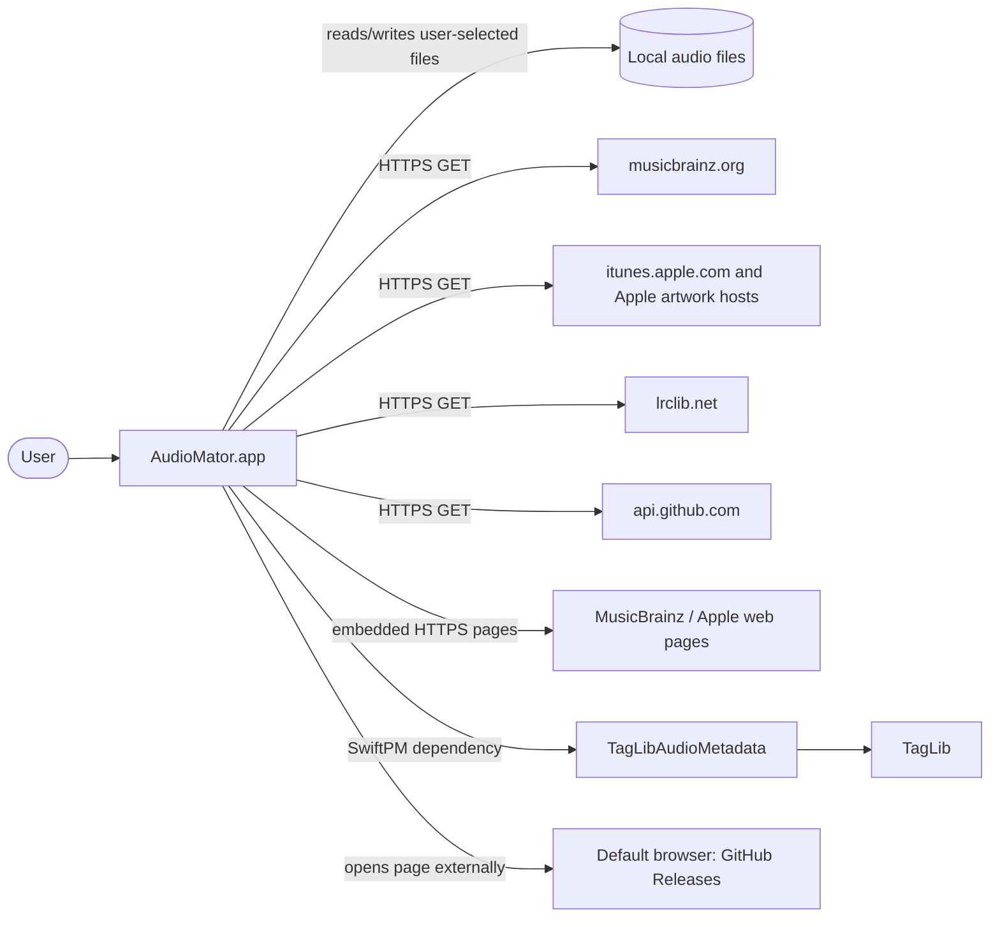
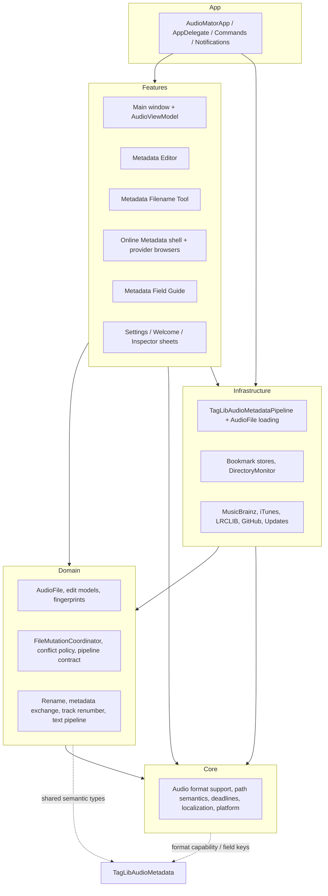
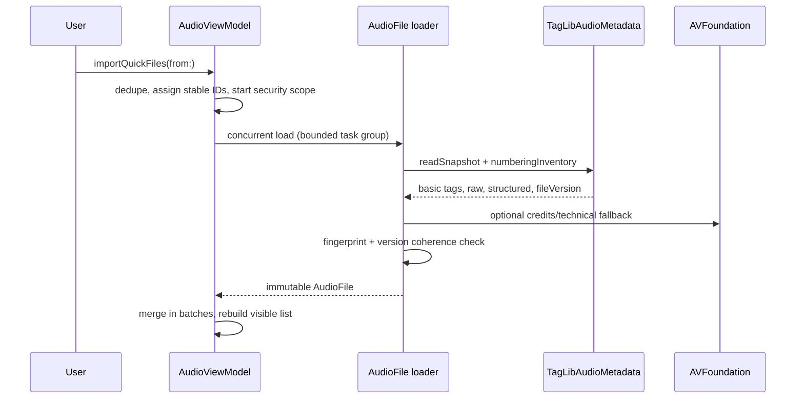
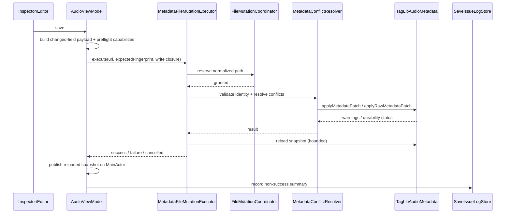

# Architecture Overview

AudioMator is a single macOS application target assembled from layered source folders under `AudioMator/`. The application is deliberately small at the center: a SwiftUI app shell owns lifecycle, a main-actor view model owns file state and selection, and all container-specific metadata I/O is delegated to the external `TagLibAudioMetadata` package (pinned 0.8.2, mapping contract `AM-TLAM-MAPPING-2.2`) through an adapter protocol.

This document describes the current structure. Detailed behavior lives in the linked architecture documents.

## Context

All network operations are user initiated. The app does not upload audio content. See [Security and Data Integrity](../Security/SECURITY_AND_DATA_INTEGRITY.md).

## Layer Structure

The allowed dependency direction and its documented exceptions are in [Dependency Rules](DEPENDENCY_RULES.md).

## Composition Root

`AudioMator/App/AudioMatorApp.swift` is the only composition root:

1. Creates one `TagLibAudioMetadataPipeline` and one `SaveIssueLogStore`.
2. Injects the pipeline, log store, bookmark stores, and isolated preferences into `AudioViewModel`.
3. Creates `SharedState`, `MusicBrainzBrowserStore`, `LRCLIBLyricsBrowserStore`, `MetadataFilenameToolStore`, and a `MetadataEditorStore` bound to the same pipeline.
4. Declares six scenes:
   - the main `WindowGroup` (`ContentView`), minimum 900×600,
   - the Metadata Field Guide `Window` (`MetadataFieldGuideView`; window restoration disabled),
   - `Settings` (`SettingsView`),
   - the Online Metadata window (`OnlineMetadataBrowserView`),
   - the Filename & Metadata window (`MetadataFilenameWindowView`),
   - the Metadata Editor window (`MetadataEditorWindowView`).
5. Registers app-info, field-guide, sidebar, toolbar-edit, and view-layout commands, plus a Help-menu "Show Welcome Screen" action.

The `AudioMatorTestHost` path substitutes temporary preferences and a temporary issue-log file so the serial XCTest host does not restore developer bookmarks. Feature views receive dependencies explicitly; there is no service locator and no feature-level singleton for metadata I/O.

## Application Lifecycle

- `AudioMatorApp` is the `@main` SwiftUI app and installs `AppDelegate` through `NSApplicationDelegateAdaptor`.
- On first launch, `AppDelegate` checks `hasLaunchedBefore`, centers the first window, and stores the flag. The SwiftUI scene supplies the default size for new main windows. macOS restores the previous size for restored windows.
- The app terminates when the last window closes (`applicationShouldTerminateAfterLastWindowClosed`).
- The welcome sheet is presented when `WelcomeSplashProgress.shouldPresent` reports incomplete or outdated onboarding (`hasCompletedWelcomeSplash` / `completedWelcomeSplashVersion`, current version 3). It can be reopened from Settings or the Help menu.
- Commands and cross-window actions communicate through `NotificationCenter` names in `AppNotifications.swift` or through injected bindings. The main window handles metadata dump, track renumber, online metadata, filename/metadata tool, metadata editor, clear-list confirmation, select-all, sidebar change, inspector toggle, and welcome-screen requests.
- `ContentView` reconciles the selected files when `NSApplication.didBecomeActiveNotification` fires.

## UI Composition

- The main window uses a `NavigationSplitView` for the sidebar and middle content pane. SwiftUI's full-height `.inspector` modifier is applied to the split view, and the column width is constrained to 340–480 points. The Inspector hosts Cancel, Save, and Hide Inspector in its toolbar. The View menu toggles the column through the same visibility action as Hide Inspector.
- The middle pane requests a 680-point minimum and a 760-point ideal width. The window uses `.contentMinSize` with a 1,240-point minimum width while the Inspector is open and 900 points while it is closed. The minimum height is 600 points.
- The middle list uses an AppKit-backed table (`MiddleListTable`) bridged into SwiftUI for native selection and column behavior. Selection is mirrored back to `AudioViewModel`; rejected draft-discard changes restore the previous native selection.
- Sidebar sources are Quick Import (current session) and Watched Folders (the flat watched library plus individual watched folders that expand into their on-disk subfolder hierarchy via `WatchedFolderHierarchy`). Switching source or subfolder changes the visible file collection and prunes selection to visible tracks.
- The Inspector binds to `SingleFileEditModel` or `MultiFileEditModel`. It does not own file state.
- Metadata Editor, Filename & Metadata, and Online Metadata are separate `Window` scenes with their own stores. They receive the shared `AudioViewModel` and pipeline by injection. The Metadata Field Guide is a separate read-only `Window` scene.
- Settings is a separate `Settings` scene with six tabs: General, Interface, Folders, Conflicts, Logs, About.
- Progress and transient results are shown through a main-window overlay/HUD queue; non-success summaries also feed the local save issue log.

## Major Components

| Component | Responsibility | Key files |
| --- | --- | --- |
| `AudioViewModel` | Main-actor owner of loaded files, watched folders, selection, inspector drafts, progress/HUDs, file-access scopes, and batch orchestration. | `Features/Main/ViewModels/AudioViewModel*.swift` |
| `SharedState` | Sidebar selection, sort order, manual list order, and persisted presentation preferences. | `Features/Main/State/SharedState.swift` |
| `SingleFileEditModel` / `MultiFileEditModel` | Draft values independent of disk snapshots; computes changed fields and mixed state. | `Domain/AudioFiles/SingleFileEditModel.swift` |
| `AudioMetadataPipeline` | Domain contract for loading, versioning, semantic writes, raw patches and erase. | `Domain/MetadataEditing/AudioMetadataPipeline.swift` |
| `TagLibAudioMetadataPipeline` | Adapter that translates app intent to package patches and interprets package errors/results. | `Infrastructure/TagLib/TagLibAudioMetadataPipeline.swift` |
| `AudioFile` loader | Builds the immutable snapshot from a TagLib snapshot plus AVFoundation fallback and verifies a coherent revision. | `Infrastructure/TagLib/AudioFile+TagLibLoading.swift` |
| `FileMutationCoordinator` | Actor that serializes mutations by normalized file path and supports atomic multi-path reservations. | `Domain/MetadataEditing/FileMutationCoordinator.swift` |
| `MetadataFileMutationExecutor` | One file's write lifecycle: fingerprint validation, commit, bounded reload, structured outcome. | `Features/Main/Application/MetadataFileMutationExecutor.swift` |
| `MetadataConflictResolver` | Rebase/merge/priority behavior when a revision changes between draft and save. | `Infrastructure/TagLib/MetadataConflictResolver.swift` |
| `MetadataBatchExecutor` | Bounded concurrency (maximum four) for independent per-file mutations. | `Features/Main/Application/MetadataBatchExecutor.swift` |
| `MetadataExchangePlanner` / `FileRenamePlan` | Pure planning for import/export and rename previews. | `Domain/MetadataExchange`, `Domain/Rename` |
| Provider stores | Main-actor search state, cancellation, timeouts, plan construction, and apply entry points. | `Features/MusicBrainzBrowser`, `Features/iTunesBrowser`, `Features/LRCLIBLyricsBrowser` |
| Provider clients | URL construction, decoding, mapping, throttling, caching, error translation. | `Infrastructure/MusicBrainz`, `Infrastructure/iTunes`, `Infrastructure/LRCLIB` |

## Runtime Data Flow

### Import

Quick Import loads with `min(max(activeProcessorCount × 2, 6), min(12, count))` concurrent tasks and publishes partial batches: flush at 48 pending items immediately, or at 24 items after a 200 ms minimum interval. A failed source read remains a failure; one transient read retry is allowed during import to accommodate file-provider materialization.

### Selection and Drafts

`AudioViewModel.setSelectedAudioIDs` filters requested IDs against the visible collection and rebuilds the draft in the same main-actor operation. One selected file creates a `SingleFileEditModel`; multiple selected files create a `MultiFileEditModel`. The draft's source snapshots are retained separately from the live list so a background refresh cannot silently change the save baseline.

The draft carries its own session identity, captured target baselines and monotonic edit/artwork command generations. Passive refresh never replaces a dirty draft or its original expected revision; only a named explicit transition, a clean refresh or an own-save completion changes the model. A successful save advances baselines per field from the accepted readback and reapplies newer edits. If a dirty draft's captured files become unavailable, the selection is still pruned but the payload and baselines are kept as a detached pending review; Save stays suspended until the files return and the user resumes, or the user discards it.

### Save

A synchronous TagLib commit cannot be interrupted once it starts. Cancellation is honored while queued and before the write begins; after that, the real commit result is observed. The reload after a successful commit is independently bounded (60 seconds) and its failure is reported as a warning, never as a failed write.

### Rename

Rename is a durable two-phase transaction plus a bounded readback:

1. `RenameTransactionService` records one versioned `prepared` journal manifest (absolute original/temporary/intended URLs and captured entry identity evidence) durably, stages every source to a deterministic hidden same-directory name with `renameatx_np(RENAME_EXCL)` on held directory descriptors, then finalizes destinations after every source is staged. Each move is verified against the captured directory-entry identity; unsupported volumes are rejected before staging. Failures roll back finalized then staged files in reverse order; an incomplete rollback retains the prepared record. After all identities verify and audio directories are flushed, the record is rewritten as `committed` before it is removed. Throughout, one union reservation and a stable cross-process journal lock serialize app-owned work.
2. After the move reservation is released, each destination is reacquired under its own reservation for a bounded (60 second) full read. The entry identity must still match before the read and after it; only that coherent observation restores write authority and clears the pending decision.

Startup loads journal records read-only, installs path-keyed mutation blocks, classifies in the background and never moves files automatically. **Settings > Folders > Rename Recovery** offers explicit, identity-checked restore of original names (no overwrite, idempotent across interruption) for prepared records, and explicit removal of verified committed/no-move records.

A failed or timed-out readback leaves the moved file as an authority-free display projection with metadata editing paused. Stat-only or version-only probes never restore a writable revision, and an external program can still change the path between the two phases; that external-writer race limit is documented in [Rename and Renumbering](RENAME_AND_RENUMBERING.md).

### Online Metadata

Provider stores own their search tasks and cancellation. Applying results constructs a write plan with the source snapshot's expected fingerprint; the same `AudioViewModel` write path performs the mutation. LRCLIB lyrics are applied as a raw `LYRICS` patch rather than a full property-map rewrite. The LRCLIB store also owns one browser session generation and one search-to-write operation: the reviewed target (fingerprint and package version) is captured with each seed query, writes go through the shared strict reviewed-write route, and close/Back/reseed cancel outstanding lookups and unstarted writes while an admitted commit still reports its real outcome.

## State Ownership

| State | Owner | Lifetime |
| --- | --- | --- |
| Loaded files and watched-folder lists | `AudioViewModel` | Session |
| Selection | `AudioViewModel` | Session |
| Inspector drafts (payload + session/baselines/ledger + detached pending review) | `AudioViewModel` (`InspectorDraftSession`) | Session |
| Metadata Editor draft (raw editor sessions/apply) | `MetadataEditorStore` | Session/window presentation |
| Sidebar choice, sort, column/toolbar/inspector-field visibility | `SharedState` | Session, with `UserDefaults` persistence |
| Watched folders and file-access grants | `WatchedFolderStore`, `FileAccessGrantStore` | Persisted bookmarks in `UserDefaults` |
| Conflict policy | `MetadataConflictPolicy.load` from `metadata.conflictPolicy` | Persisted |
| Save issue log | `SaveIssueLogStore` | `Application Support/AudioMator/SaveIssueLog.json`, capped at 200 entries |
| Rename recovery journal | `RenameTransactionService`, `RenameJournalStore`; presentation/path blocks in `AudioViewModel` | Versioned manifests + stable lock in `Application Support/AudioMator/RenameJournal/`, retained until restore, acknowledgement, or verified completion |
| Provider search state | Provider stores | Feature/window lifetime |

No view owns authoritative file state. Views bind to observable owners and send explicit intents.

## Concurrency Model

- The UI and all view models are main-actor isolated. The project sets `SWIFT_DEFAULT_ACTOR_ISOLATION = MainActor`.
- File loading, TagLib snapshots, and writes run in detached tasks or task groups so the main actor is not blocked by I/O.
- `FileMutationCoordinator` is an actor providing path-level exclusive access.
- Different files may be written concurrently (maximum four by `MetadataBatchExecutor`); the same normalized path is always serialized.
- `withAsyncTimeout` bounds reloads, provider operations, and other awaits that could hang. Timeouts do not cancel an already-started synchronous TagLib write.
- Refresh generations and snapshot IDs prevent a late result from replacing a newer file model.

## Error Propagation and Recovery

Errors are converted to structured outcomes close to the operation:

- `MetadataFileMutationResult`: success (with optional reload warning), failure, cancelled.
- `AudioMetadataCommitStatus`: durable, or durability uncertain after commit.
- `RenameExecutionOutcome`: committed receipts, verified rollback, unresolved with a read-only classification, rejected, or busy. A prepared or committed journal record survives process termination for explicit restart recovery.
- Provider errors: typed client errors mapped to user-facing messages.
- Batch results: per-file success, warning, or failure; never a group transaction.

Recovery rules:

- A failed write leaves the snapshot and draft unchanged.
- A successful write with a failed reload reports persisted-with-warning; the app does not invent a new snapshot.
- A rename with incomplete rollback retains a prepared journal record and reports every observed candidate location; it is never repaired automatically.
- A committed journal record left by termination keeps the new names and only offers explicit acknowledgement; a prepared record only offers explicit, identity-checked restore.
- A blocked journal path rejects metadata writes and rename planning until the recorded operation is restored or acknowledged.
- A replaced or unreadable file stops version-checked writes rather than guessing at a replacement.

## Extension Points

The code is extended by conforming to existing protocols and injecting at the composition root:

- `AudioMetadataPipeline` — alternative metadata backends and test fakes.
- `MusicBrainzBrowserClient`, `iTunesBrowserClient`, `LRCLIBLyricsSearching`, `iTunesArtworkServicing` — provider clients and test doubles.
- `RenameFileSystem` — exclusive same-directory move, held-directory and durability seam.
- `RenameJournalStoring` — versioned durable journal and stable lock seam.
- `UpdateReleaseProviding` — update source.
- `DirectoryMonitor` and the bookmark stores — filesystem integration.

There is no plugin system, scripting surface, or public framework API. All types are internal to the app target.

## Architectural Constraints

- macOS only. There is no iOS/iPadOS target or compatibility layer.
- App Sandbox with user-selected read/write and outgoing network client entitlements.
- Domain code must not call TagLib managers or own file transactions.
- UI code must not write container metadata or move files directly.
- All disk mutations go through the shared path coordinator.
- Semantic writes preflight the exact requested fields, not only the extension.
- The raw editor is the deliberate low-level exception; it still uses the shared reservation and the package's version guard.

## Where to Go Next

- [State and Mutation Model](STATE_AND_MUTATION_MODEL.md)
- [Metadata Pipeline](METADATA_PIPELINE.md)
- [Metadata Mapping Specification](METADATA_MAPPING_SPEC.md)
- [File Revision and Reload](FILE_REVISION_AND_RELOAD.md)
- [Metadata Exchange](METADATA_EXCHANGE.md)
- [Rename and Renumbering](RENAME_AND_RENUMBERING.md)
- [Online Metadata](ONLINE_METADATA.md)
- [Dependency Rules](DEPENDENCY_RULES.md)
- [Architecture Decision Records](Decisions/README.md)
