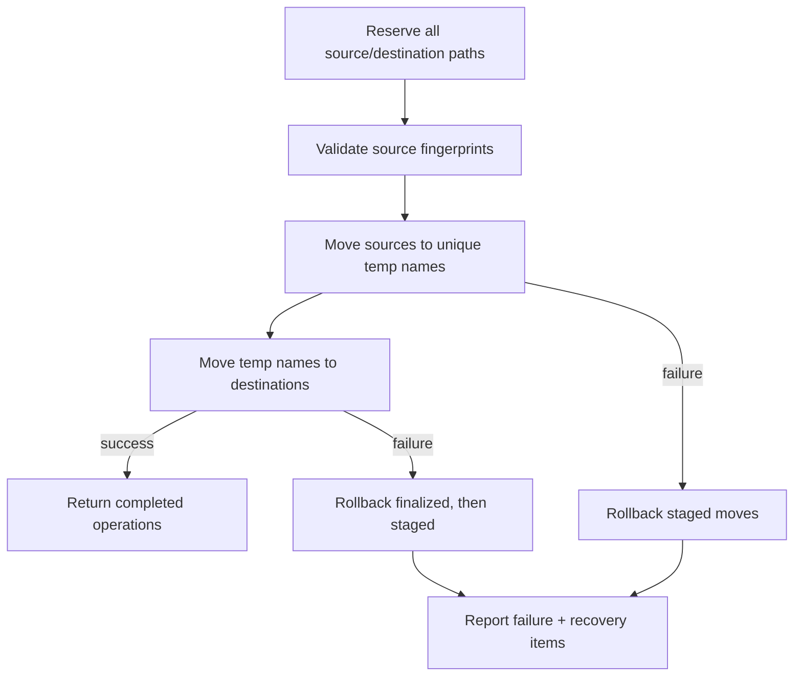

# Rename and Renumbering

This document covers two filesystem/metadata operations: renaming files from templates and rewriting track numbers from list order.

## Rename

### Planning

`makeFileRenamePlan(template:targetFiles:)` in `Domain/Rename/FileRenameTemplate.swift` renders each file's base name from the template, preserves the original extension, sanitizes unsafe characters, and produces a `FileRenamePlan` with per-row status.

Statuses include:

- `ready`,
- `unchanged`,
- `emptyName`,
- `nameTooLong`,
- `sourceUnavailable`,
- `duplicateTarget`,
- `existingFile`.

`FileRenameCollisionPolicy` handles duplicate destinations and existing files. If file A will move out of a name that file B wants, the plan allows the swap or cycle because all sources move in the same transaction. A destination occupied by a file that is not also moving is an existing-file conflict.

### Sanitization

`FileRenameSanitizer` replaces:

- `/` with `-`,
- `:` with `-`,
- NUL with `-`,
- other control characters with a space,

then trims surrounding whitespace. An empty result is rejected. Unicode scalars are otherwise preserved.

### Transaction

`executeFileRenameTransaction` runs inside one multi-path reservation covering every source and destination:

1. Filter out operations whose source equals destination.
2. Choose a unique temporary name in the source directory.
3. For each operation, revalidate the source fingerprint and move the source to its temporary name.
4. Move each temporary name to its destination and capture the destination directory-entry identity.
5. On any failure, roll back finalized operations in reverse order, then staged operations.
6. If rollback is incomplete, return recovery items; a unique observed location carries the entry identity captured there.

### Recovery reporting

`FileRenameRecoveryItem` records:

- the original URL,
- the intended URL,
- every observed final location,
- one verified location plus its directory-entry identity when exactly one candidate matched,
- rollback errors.

Rollback checks that a candidate at the destination still matches the expected file before moving it back. It never overwrites a file that appeared during rollback.

### After a rename

Successful moves are published in two reservation phases:

1. **Move and placeholder publication.** The transaction returns a receipt for every
   successful move containing the claimed file ID, the lexical old URL, the actual
   destination URL, and the directory-entry identity captured at the end of the move.
   While the source/destination reservation and directory access are still held, the
   app clears the old path keys and records the new ones as one mapping update (so
   swaps cannot transiently alias), rotates the affected quick-import URL tokens,
   advances the affected file-model generations, invalidates in-flight watched-folder
   scans, and publishes an authority-free display projection with a named pending
   recovery decision. No writer can start on a destination without observing that
   decision.
2. **Bounded full readback.** After the union reservation is released, each
   destination is reacquired under the coordinator and read in full with a 60-second
   deadline (at most the existing four concurrent metadata reads). The destination
   entry identity is checked before the read and again before the result is accepted.
   Only a successful, same-entry full read produces a new coherent observation and
   clears that move's pending decision. A failed or timed-out read, or a replaced
   entry, keeps the display projection read-only and directs the user to Reload from
   Disk; no lightweight fingerprint/version probe can restore write authority.

The coordinator serializes app-owned operations only. An external program can change
the destination between the move and the readback; the before/after entry-identity
checks and the loader's own post-await fingerprint/version guard are the protections
against publishing a different entry. It is an app transaction, not a filesystem-wide
lock.

### Constraints

- Existing destination files are not overwritten.
- Each source fingerprint is validated immediately before that source is staged. A stale later source can therefore fail after earlier sources have moved, so rollback may be required.
- A rename is not a group commit: failure triggers rollback, but an incomplete rollback requires manual recovery.
- The transaction cannot overlap metadata writes to any source or destination.
- A file with an unresolved recovery decision cannot be renamed until a coherent reload or the recovery flow clears it; the planner only accepts a coherent observation fingerprint, never a fresh stat probe.

## Track Renumbering

### Inputs

`TrackRenumberOptions`:

- direction: ascending or descending,
- start number: a required positive integer from `1` to `9_999`, default `1`.

There is no zero-padding option. The preview and execution submit the stored numeric value; text formatting such as `07` is not a supported input intent. A blank, malformed, zero, negative, signed, fractional, overflowed, or Unicode-lookalike start number is an explicit invalid state that disables Apply and causes zero writes; the value is never clamped or replaced by a fallback.

### Plan and target order

`makeTrackRenumberPlan(...)` builds one `TrackRenumberPlan` from the ordered files and the current selection. Each ordered row carries a reasoned disposition (ready, unchanged, rejected, or skipped), the reviewed write target, the assigned numeric value and a frozen track-only `MetadataEditPayload` derived from the same reviewed snapshot. Preview, eligibility, counts and Apply all consume that same plan; Apply never recomputes the sequence from the current collection.

Unsupported, refresh-required, duplicate-identity and stale targets are classified before numbering and do not consume numbers. A target that already has the desired number is an unchanged numbered row: it keeps its slot and performs no disk write. A later write failure keeps its slot so following rows keep their reviewed assignments.

The UI supplies the current list order and selection:

- with no selection, every file in list order,
- with a selection, only selected files, preserving list order.

### Write behavior

For each ready row, in order:

1. Revalidate the captured reviewed target against current membership, path identity and recovery state.
2. Submit the frozen track-number component intent through the reviewed executor with the captured nonoptional metadata revision. The existing total, the complete disc group and unrelated fields are carried as untouched values and are not removed.
3. Reload the snapshot from disk and report success, warnings, or failure per file.

Renumbering is serial and uses the same reviewed-write reservation, commit permit and bounded readback as other metadata writes and erase. It does not modify disc numbers.

### Results

`TrackRenumberResult` reports total targets, succeeded, unchanged, skipped unsupported, skipped duplicates, failed, any start validation message, per-file failures, and per-file warnings. The UI displays the summary; there is no group rollback.

### Constraints

- Track totals are preflighted and preserved; renumbering never clears a total.
- The operation writes a typed number component, not a formatting-only text patch and not a full semantic replacement. Disc numbers and their totals are preserved.
- Ambiguous or invalid legacy number candidates make the package reject the write; renumbering reports the failure and does not pick a candidate.
- Renumbering never performs private-atom cleanup; typed component patches leave legacy aliases and unrelated keys untouched.
- Containers may normalize number representation. Verification compares numeric component values; a text-only difference is not by itself a failed write. Package warnings are surfaced as returned. An unchanged numeric value performs no write, so padded original raw text is preserved when its numeric value already matches.
- Unsupported formats are skipped rather than force-written.

## Tests

- Filename template parsing, sanitization, collisions, and extraction: `FileRenameTemplateTests`, `FilenameMetadataTemplateTests`, `AudioMatorCoreLogicTests`.
- Independent filename tokens: `year` keeps complete stored YEAR text; `date`, `releaseDate` and `originalReleaseDate` edit only their own field. Extraction applies only the explicitly targeted field.
- Transaction rollback and recovery: `FileRenameTransactionTests`.
- Post-rename refresh safety: `RenameRefreshSafetyTests`.
- Renumber start policy, plan rows and dispositions: `TrackRenumberTests` (plus the Foundation-only start policy in `AudioMatorCoreLogicTests`).
- Renumber strict execution, verification, cancellation and disk readback: `TrackRenumberExecutionTests`.
- Real FLAC/MP3/M4A renumber round trips: `TrackRenumberRoundTripTests`.

Interactive preview UI is not covered by automated UI tests.

## Recovery Publication Ordering

Incomplete rollback reconciles each recovery item by file ID. A single verified location is rebound through the same two-phase receipt/readback path; an unknown, ambiguous, or replaced location disables writes. Recording a recovery decision also discards queued reloads, advances the file's publication generation, and invalidates in-flight watched-folder scans and old-URL import tokens so older observations cannot undo that safety state. Recovery decisions are named reasons (pending move readback, unresolved recovery location, F2 journal) and are cleared only by their matching transition; automatic activation, watched-folder reads, and quick reimport clear none.

Renumbering treats a committed-but-durability-uncertain outcome as a successful write with a warning, matching other metadata writers. It reports the directory-sync detail and advises against retrying the committed save.

## Renumber Eligibility and Cancellation

Only format-capable targets with a verified loaded revision participate in number assignment. Refresh-required targets are reported as failures before directory-access prompting and do not consume numbers. A runtime write failure may still leave a gap; renumbering does not retry or roll back committed files. Cancellation stops before the next target. The current commit and readback finish under their mutation reservation, and the result retains committed successes and records every unprocessed target as cancelled.

## Related Documents

- [Metadata Exchange](METADATA_EXCHANGE.md)
- [State and Mutation Model](STATE_AND_MUTATION_MODEL.md)
- [File Revision and Reload](FILE_REVISION_AND_RELOAD.md)
