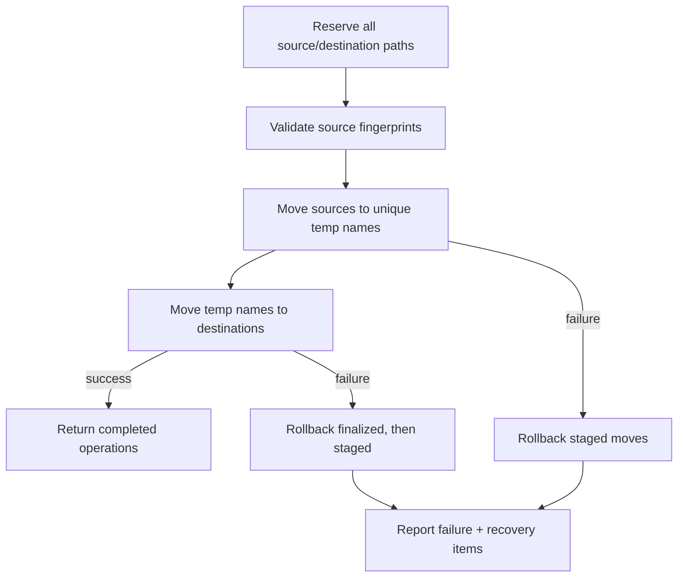

# Rename and Renumbering

This document covers two filesystem/metadata operations: renaming files from templates and rewriting track numbers from list order.

## Rename

### Planning

`makeFileRenamePlan(template:targetFiles:)` in `Domain/Rename/FileRenameTemplate.swift` renders each file's base name from the template, preserves the original extension, sanitizes unsafe characters, and produces a `FileRenamePlan` with per-row status.

Statuses include:

- `ready`,
- `unchanged`,
- `emptyName`,
- `nameTooLong`,
- `sourceUnavailable`,
- `duplicateTarget`,
- `existingFile`.

`FileRenameCollisionPolicy` handles duplicate destinations and existing files. If file A will move out of a name that file B wants, the plan allows the swap or cycle because all sources move in the same transaction. A destination occupied by a file that is not also moving is an existing-file conflict.

### Sanitization

`FileRenameSanitizer` replaces:

- `/` with `-`,
- `:` with `-`,
- NUL with `-`,
- other control characters with a space,

then trims surrounding whitespace. An empty result is rejected. Unicode scalars are otherwise preserved.

### Transaction

`executeFileRenameTransaction` runs inside one multi-path reservation covering every source and destination:

1. Filter out operations whose source equals destination.
2. Choose a unique temporary name in the source directory.
3. For each operation, revalidate the source fingerprint and move the source to its temporary name.
4. Move each temporary name to its destination.
5. On any failure, roll back finalized operations in reverse order, then staged operations.
6. If rollback is incomplete, return recovery items.

### Recovery reporting

`FileRenameRecoveryItem` records:

- the original URL,
- the intended URL,
- every observed final location,
- rollback errors.

Rollback checks that a candidate at the destination still matches the expected file before moving it back. It never overwrites a file that appeared during rollback.

### After a rename

Successful moves:

1. update the file IDs' URL mapping,
2. reload each new path while retaining the reservation,
3. recover the fingerprint and metadata revision independently,
4. mark the snapshot refresh-required if either cannot be recovered,
5. block version-checked metadata writes until a successful reload.

### Constraints

- Existing destination files are not overwritten.
- Sources changed after preview are rejected before any move.
- A rename is not a group commit: failure triggers rollback, but an incomplete rollback requires manual recovery.
- The transaction cannot overlap metadata writes to any source or destination.

## Track Renumbering

### Inputs

`TrackRenumberOptions`:

- direction: ascending or descending,
- start number: clamped to `0...9_999`,
- zero padding: on/off.

`trackRenumberPadWidth` returns at least width 2 when padding is enabled, based on the largest assigned number. When disabled, width is 0 (no padding).

### Target order

The UI supplies the current list order and selection:

- with no selection, every file in list order,
- with a selection, only selected files, preserving list order.

### Write behavior

For each target, in order:

1. Refuse if the snapshot is refresh-required.
2. Skip if the extension is not metadata-writable.
3. Skip if `.track` or `.trackTotal` is unsupported for the format.
4. Format the number (`07`, `7`, …).
5. Write track number text with `verifyAfterWrite: true` and the expected metadata version.
6. Reload the snapshot from disk.
7. Report success, warnings, or failure per file.

Renumbering is serial and uses the same `MetadataFileMutationExecutor` and path reservation as metadata writes and erase. It does not modify disc numbers.

### Results

`TrackRenumberResult` reports total targets, succeeded, skipped unsupported, failed, per-file failures, and per-file warnings. The UI displays the summary; there is no group rollback.

### Constraints

- Track totals are preflighted but are not rewritten by renumbering.
- The operation writes number text, not a full semantic patch.
- Containers may normalize padding. Verification checks that the numeric value round-trips; a text-only difference is reported as normalization.
- Unsupported formats are skipped rather than force-written.

## Tests

- Filename template parsing, sanitization, collisions, and extraction: `FileRenameTemplateTests`, `FilenameMetadataTemplateTests`, `AudioMatorCoreLogicTests`.
- Transaction rollback and recovery: `FileRenameTransactionTests`.
- Post-rename refresh safety: `RenameRefreshSafetyTests`.
- Renumber pad/start policy: `TrackRenumberTests`.
- Renumber execution, verification, and disk readback: `TrackRenumberExecutionTests`.

Interactive preview UI is not covered by automated UI tests.

## Related Documents

- [Metadata Exchange](METADATA_EXCHANGE.md)
- [State and Mutation Model](STATE_AND_MUTATION_MODEL.md)
- [File Revision and Reload](FILE_REVISION_AND_RELOAD.md)

## Recovery publication ordering

Incomplete rollback reconciles each recovery item by file ID. A single verified location is rebound and refreshed; an unknown or ambiguous location disables writes. Marking a file refresh-required also discards queued reloads, advances its publication generation, and invalidates in-flight watched-folder scans so older observations cannot undo that safety state.
