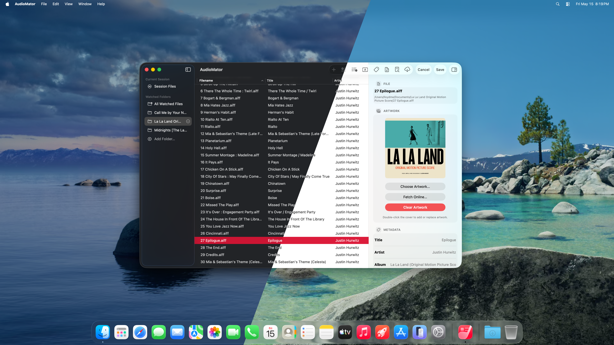

<p align="center">
  
</p>

<h1 align="center">AudioMator</h1>

<p align="center">
  <strong>Your Audio Library’s Best Mate</strong><br> Native macOS Audio Metadata Editor
</p>

<p align="center">
  
  
  
</p>

AudioMator is a local-first audio metadata editor for macOS. It inspects, edits, organizes, and enriches music files through a TagLib-powered pipeline while keeping the audio content on your Mac.

## Features

- **Inspector editing** for common fields, for one file or a multi-file selection.
- **Metadata Editor** for the raw TagLib PropertyMap projection, preserving ordered value lists, duplicates, whitespace, and literal semicolons.
- **Tag Inspector** for read-only raw tags, ID3v2 frames, legacy sections, and compatibility notes.
- **Filename & Metadata** conversion across seven modes: metadata→filename, filename→metadata, metadata→text, text→metadata, metadata→CSV, CSV→metadata, and field copy/cut.
- **Track renumbering** by list or selection order, with direction, start number, and zero-padding.
- **Artwork replacement** from local images or clipboard data, plus optional iTunes artwork lookup.
- **Online metadata** from MusicBrainz, the Apple iTunes Search API, and LRCLIB synced lyrics, always user initiated.
- **Watched folders** with security-scoped bookmarks, debounced rescans, and bounded directory monitoring.
- **Conflict strategies** for Inspector and Metadata Editor drafts when files change on disk.
- **Local save issue log** for non-success batch outcomes.
- **MuseAmp compatibility IDs** as an optional integration.

## Screenshot

<p align="center">
  
</p>

More images are available under [`Docs/Images`](Docs/Images).

## Requirements

- macOS 15.0 or later.
- For development: stable Xcode 27 and network access the first time `TagLibAudioMetadata` is resolved.

The app is sandboxed, uses Hardened Runtime, and requires user-selected file access for editing.

## Build From Source

```bash
git clone https://github.com/ChrisLloydME/AudioMator.git
cd AudioMator
open AudioMator.xcodeproj
```

Select the `AudioMator` scheme and build. Command-line validation:

```bash
swift test
bash scripts/codex-build.sh --force
```

The app-hosted test suite must run serially:

```bash
xcodebuild \
  -project AudioMator.xcodeproj \
  -scheme AudioMator \
  -configuration Debug \
  -destination 'platform=macOS' \
  -derivedDataPath .deriveddata-codex \
  -parallel-testing-enabled NO \
  -maximum-parallel-testing-workers 1 \
  test
```

See [Build](Docs/Development/BUILD.md) and [Testing](Docs/Development/TESTING.md) for details, known gaps, and troubleshooting.

## Installation and Distribution

Release artifacts are published at [GitHub Releases](https://github.com/ChrisLloydME/AudioMator/releases). The repository does not contain signing, notarization, packaging, or release-upload automation; verify a distributed build's signing status independently.

The app's manual **Check for Updates…** flow reads the latest GitHub release and opens the releases page for download. It does not install updates.

## Supported Formats

Readable, writable, and artwork-writable extensions are discovered from `TagLibAudioMetadata` at runtime, and writable fields are preflighted per format. A readable format is not automatically writable, and container behavior differs by format.

The current expected format set, field-capability model, and limitations are documented in [Product Overview → Supported Formats](Docs/Product/OVERVIEW.md#supported-formats), [Metadata Pipeline](Docs/Architecture/METADATA_PIPELINE.md), and [Dependency Limitations](Docs/Reference/DEPENDENCY_LIMITATIONS.md).

## Track and Disc Numbers

Track and disc data is stored as structured fields:

- `Track Number`
- `Total Tracks`
- `Disc Number`
- `Total Discs`

AudioMator submits numeric values and user-facing text intent separately. Containers may normalize combined text such as `02/09` while preserving the numbers; write verification distinguishes normalization from a real mismatch.

Year and Release Date are separate edit intents. MP4 has one standard date slot, so an independent Year edit can be rejected instead of overwriting Release Date.

## Privacy and Network Use

AudioMator is local-first. Ordinary editing, raw inspection, filename tools, renumbering, and local artwork replacement are on-device. The app does not upload audio content and has no telemetry.

Network requests happen only when you explicitly start:

- MusicBrainz lookup (`musicbrainz.org`),
- iTunes metadata/artwork lookup (`itunes.apple.com` and Apple artwork hosts),
- LRCLIB lyrics lookup (`lrclib.net`),
- release notes or update checks (`api.github.com`).

Requests can include metadata-, filename-, or parent-folder-derived search terms. Embedded MusicBrainz/Apple pages can load additional web content. See [Acknowledgements and Privacy](Docs/ACKNOWLEDGEMENTS_AND_PRIVACY.md) and [Online Metadata](Docs/Architecture/ONLINE_METADATA.md) for the exact data sent.

## Documentation

The authoritative documentation set starts at [`Docs/README.md`](Docs/README.md).

- [Product Overview](Docs/Product/OVERVIEW.md)
- [User Guide](Docs/Product/USER_GUIDE.md)
- [Architecture Overview](Docs/Architecture/OVERVIEW.md)
- [Metadata Pipeline](Docs/Architecture/METADATA_PIPELINE.md)
- [File Revision and Reload](Docs/Architecture/FILE_REVISION_AND_RELOAD.md)
- [Build](Docs/Development/BUILD.md)
- [Testing](Docs/Development/TESTING.md)
- [Release Engineering](Docs/Development/RELEASE.md)
- [Security and Data Integrity](Docs/Security/SECURITY_AND_DATA_INTEGRITY.md)
- [Contributing](CONTRIBUTING.md)
- [Security Policy](SECURITY.md)
- [Agent Guide](AGENTS.md)

## Repository Layout

```text
AudioMator/            App source
  App/                 Entry points, commands, notifications
  Core/                Shared Foundation/system support
  Domain/              Metadata, rename, exchange, renumber rules
  Features/            Native UI and feature view models
  Infrastructure/      TagLib adapter, file system, providers, updates
AudioMatorTests/       App-hosted tests and fixtures
Config/                Info.plist and entitlements
Docs/                  Documentation and images
Tests/                 SwiftPM fast tests
scripts/               Build and validation helpers
```

`AudioMator/` is attached to the app target through Xcode's file-system synchronized root, so app source under that folder compiles into the app. `Package.swift` separately compiles a selected Foundation-only subset of those files for fast tests; it is not the app module. See [Project Structure](Docs/Reference/PROJECT_STRUCTURE.md) and [Configuration](Docs/Reference/CONFIGURATION.md).

## Dependencies

- [`TagLibAudioMetadata`](https://github.com/ChrisLloydME/TagLibAudioMetadata) 0.5.3 — TagLib-backed container metadata operations, verification, and atomic commit.
- TagLib — used through that package; not vendored in this repository.
- Apple frameworks — SwiftUI, AppKit, AVFoundation, CoreMedia, UniformTypeIdentifiers.

See [Third-Party Notices](Docs/THIRD_PARTY_NOTICES.md) for licensing and service obligations.

## License

AudioMator is licensed under the GNU Affero General Public License v3.0. See [`LICENSE`](LICENSE).

## Contact

E-mail: AudioMator@lloydME.com

Project: <https://github.com/ChrisLloydME/AudioMator>
